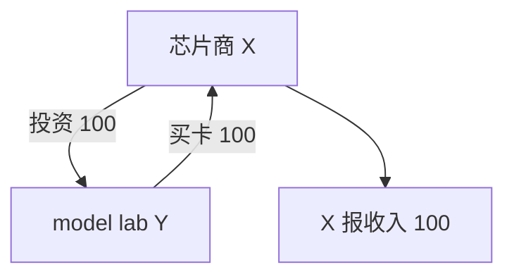

## Q
**Circular financing · 结构**｜摘要 · 必会

芯片商投资 model lab，lab 再拿这笔钱去买这家芯片商的卡。这一圈钱在会计上怎么算收入？为什么有人觉得危险？

## A
**结构（虚构数字，仅演示）：**
- 芯片商 X 向 lab Y 投资 100；
- Y 用这 100 向 X（或经云厂商）购买 GPU；
- X 确认收入 100，同时账上多一笔对 Y 的投资。

**问题不在合法，而在信息：**
- 收入是真的，但需求来自 X 自己出的钱，而不是终端用户的付费。
- 如果 Y 融不到下一轮钱，X 的收入和对 Y 的投资估值**同时**受影响。
- **Cross-holding（交叉持股）**：A 持有 B 的股份，B 也持有 A 的，估值互相支撑。

**中性的看法：** 这类安排也有正常商业理由（锁定供应、绑定生态）。要看的是占比有多大、是否披露。

出处

通用会计与披露概念（收入确认、关联交易）；本卡数字为演示用虚构数字，非任何公司数据。

