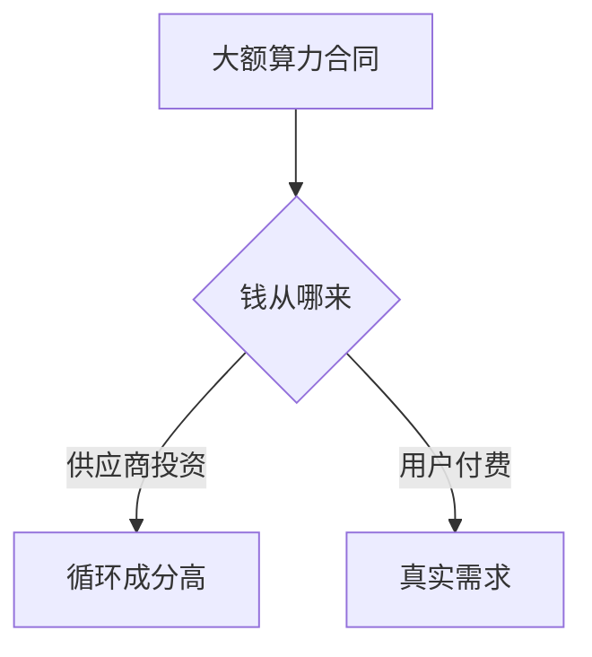

## Q
**Circular financing · 怎么判断**｜怎么读 · 必会

一家云厂商宣布「与某 lab 签了价值数百亿美元的算力合同」。你怎么判断这个需求是真实终端需求，还是循环出来的？

## A
**四个问题，按顺序问：**

| # | 问题 | 去哪找 |
|---|---|---|
| 1 | 这个客户的钱从哪来？是自己赚的，还是供应商或股东刚投的？ | 融资新闻、10-K 的投资与关联方附注 |
| 2 | 合同是**承诺**还是**意向**？ | 10-K 的 RPO（remaining performance obligations，已签约但尚未确认的收入） |
| 3 | 客户集中度多高？ | 10-K 的 customer concentration 附注（占收入 10% 以上的客户必须披露） |
| 4 | 终端有没有独立的付费用户增长？ | 应用收入、API 用量、企业采用调查 |

**判断：** 1 为「供应商出钱」且 3 很高，循环成分大；4 持续增长，说明圈外有真实需求。

**事实参照：** NVIDIA 2026 财年 10-K：一个直接客户占收入 22%，另一个 14%；上一年是 12%、11%、11%（直接客户，不含间接客户）。

出处

NVIDIA FY2026 10-K customer concentration（经 MarketScreener 转载页核对）。

