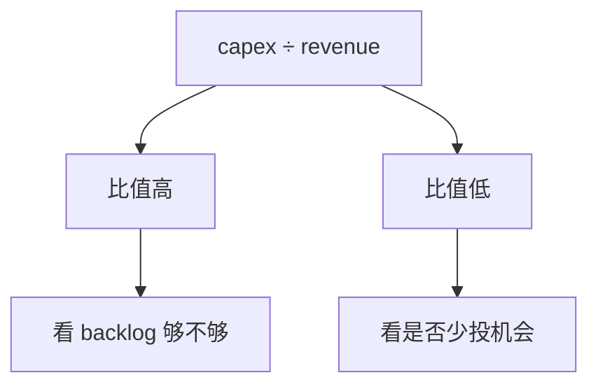

## Q
**Capex-to-revenue**｜考点 · 追问

某云公司一年收入 1000 亿美元，capex 800 亿美元；另一家收入 1000 亿、capex 200 亿。这个比值能说明什么，不能说明什么？

## A
**比值 = capex ÷ revenue。** 前者 0.8，后者 0.2。

| 能说明 | 不能说明 |
|---|---|
| 公司把多少收入再投回设备 | 这些设备会不会被用满 |
| 现金压力：高比值 → 自由现金流可能为负 | 投的是 AI 还是传统业务（要看分部披露） |
| 对未来折旧的预告：capex 今天花，折旧未来几年进利润表 | 回报期：这要看 payback，后面 unit economics 一卡会讲 |

**配套三问：** capex 里多少是土地和厂房（寿命长）、多少是 GPU（寿命短）？capex 是否包含融资租赁（finance lease，租来的设备）？指引是上调还是下调？

出处

通用财务分析方法；数字为演示用。

