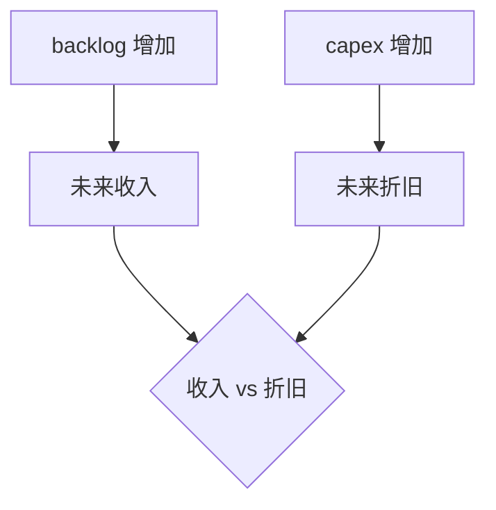

## Q
**Hyperscaler 财报 · 三个数**｜怎么读 · 必会

Alphabet 季报说 Google Cloud 收入同比 +103%。要判断这是「AI 需求真实」还是「一次性冲高」，你还需要同一份财报里的哪两个数？

## A
**事实：** Alphabet 2026 年第三季度（2026-10-28 发布）：Google Cloud 收入 307.1 亿美元，上年同期 151.6 亿美元，+103%（据 9to5Google 引述 CEO 原话「Google Cloud revenues grew 103%」）。

**三个数一起看：**

| 数 | 含义 | 为什么要看 |
|---|---|---|
| Cloud revenue growth | 已确认的收入增速 | 滞后指标：今天收的是前面签的合同 |
| Backlog（合同积压，也叫 RPO） | 已签约、尚未确认的收入 | 领先指标：未来几个季度的收入保底 |
| Capex guidance | 管理层对全年资本开支的预期 | 成本端：收入增长是靠砸钱买来的吗？ |

**比值：** capex ÷ cloud revenue 看一块钱收入背后砸了几块钱设备。backlog 需要看有多少会在 24 个月内转为收入，越短越可靠。

**出处：** Alphabet Q3 2026 earnings 报道（9to5google.com, 2026-10-28）；backlog 与 capex 的具体数字请直接读 Alphabet 10-Q，本卡不引用。
