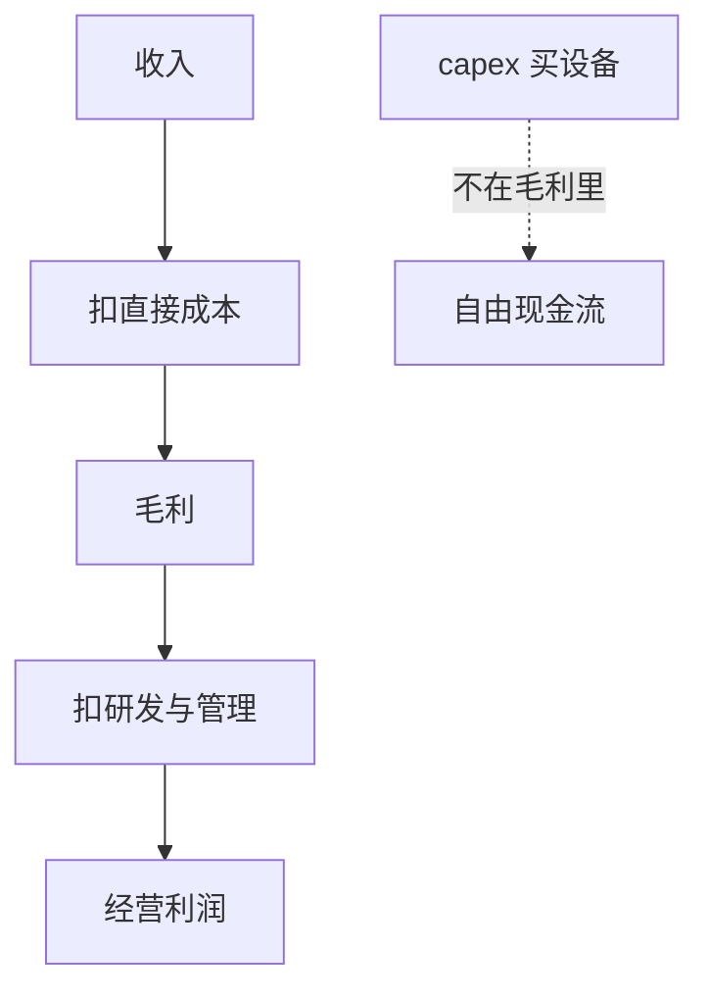

## Q
**Gross margin 与 cash flow**｜摘要 · 必会

「毛利高」和「现金流好」是一回事吗？AI 价值链的哪一层毛利高但现金很紧，哪一层毛利一般但是现金牛？

## A
**先定义：**（10-K 是美国上市公司的年度报告，后面有专门一卡讲读法）
- **Gross margin（毛利率）** = (收入 − 直接成本) ÷ 收入。只扣卖这件东西的直接成本，不含研发和管理费。
- **Cash flow（现金流）** = 实际进出的钱。买设备、建机房的钱是 **capex**（capital expenditure，资本开支），不进毛利，却是真正的现金流出。

| 层 | 毛利 | 现金流的特点 |
|---|---|---|
| 芯片设计 | 高：2026 财年 NVIDIA GAAP 毛利率 71.1%（上一年 75.0%） | 轻资产，制造外包给 foundry，现金回收快 |
| 云 | 中：靠 GPU 利用率；折旧（设备成本按年分摊）是大头 | capex 先花后收，自由现金流可能为负 |
| Model lab | 推理有毛利；训练成本是另一笔大支出 | 融资续命，烧钱 |
| 应用 | 受推理成本挤压 | 取决于模型涨价或降价 |

**要点：** 毛利高 ≠ 现金好。判断一家公司，毛利率、capex、经营现金流三个数要一起看。

**出处：** NVIDIA FY2026 10-K MD&A（毛利率 71.1% vs 75.0%）；定义为通用会计概念。
