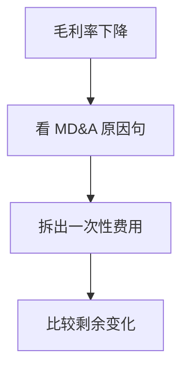

## Q
**毛利率下降 · 怎么判断**｜考点 · 追问

NVIDIA 2026 财年毛利率从 75.0% 降到 71.1%。这是「竞争变激烈、被迫降价」的信号吗？你要去 10-K 的哪里找答案？

## A
**不是定论，要读 MD&A**（Management's Discussion and Analysis，管理层对业绩变化的文字解释）。10-K 原文给了三个原因：

| 原因 | 原文要点 |
|---|---|
| 产品形态变化 | 业务从卖 Hopper HGX（服务器板）转为卖 Blackwell 整套数据中心方案 |
| 一次性减值 | 与 H20（专为中国市场设计的芯片）库存和采购承诺相关的 45 亿美元费用 |
| 库存拨备 | 库存及采购承诺拨备合计 72 亿美元（上一年 37 亿美元），对毛利的净影响分别是 2.6 与 2.3 个百分点 |

**读法：** 把一次性费用加回去再比较，才是价格与产品组合的真实变化。方法是先找「decreased due to」这类句子，再看 note 里的金额。

**出处：** NVIDIA FY2026 10-K MD&A（经 MarketScreener 转载页核对原句）；NVIDIA Q4 FY2026 新闻稿（毛利率 71.1%/75.0%）。
