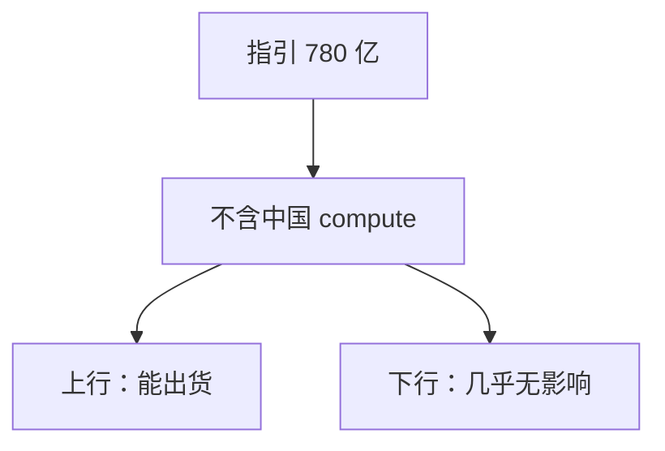

## Q
**NVIDIA guidance 里的一句话**｜怎么读 · 追问

NVIDIA 给下一季度的 guidance（管理层对未来的收入预期）里写「不假设来自中国的 data center compute 收入」。这句话在财报里对你读数字意味着什么？

## A
**事实（2026-02 新闻稿）：** 2027 财年第一季度收入指引 780 亿美元，上下 2%；指引**不含**任何来自中国的 data center compute 收入。毛利率指引 GAAP 74.9%，上下 50 个基点（0.5 个百分点）。

**怎么读：**
- 这是**保守基线**：中国收入若能出货，是在指引之上的上行；若不能，指引不受影响。
- 与上一年对照：2026 财年里有 45 亿美元与 H20 相关的库存与采购承诺费用，说明政策变化会直接进入利润表。
- 所以看到「需求下降」之前，先分清是需求没了，还是**出口政策**让一部分市场暂时从预测里拿走。

**三个追问：** 指引的口径是什么（含或不含哪些地区）？上一次指引与实际差多少？政策变化的敏感性有多大？

**出处：** NVIDIA Q4 FY2026 新闻稿 Outlook 段；FY2026 10-K MD&A（H20 费用）。
