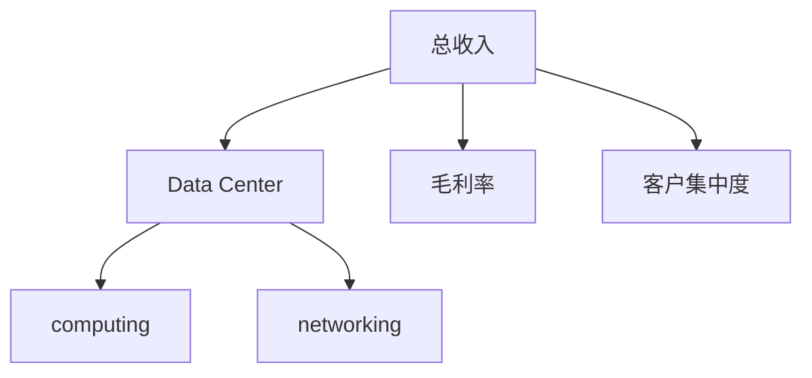

## Q
**NVIDIA 财报 · 哪些行是需求指标**｜摘要 · 必会

打开 NVIDIA 的 10-K 或季报新闻稿，哪几行能直接反映 AI 需求？2026 财年这几行是多少？

## A
NVIDIA 财年到次年 1 月底结束：「2026 财年」是 2025 年 1 月底到 2026 年 1 月 25 日。

| 行 | 2026 财年数值 | 读什么 |
|---|---|---|
| 总收入 | 2159 亿美元，同比 +65% | 整体规模 |
| Data Center revenue | 1937 亿美元，+68%（约占总收入 90%） | AI 芯片与整机的直接需求 |
| 其中 networking | 10-K 称 data center networking 增长 142%，computing 增长 59% | 集群规模靠网络，增长更快说明在建更大的集群 |
| GAAP gross margin | 71.1%（上年 75.0%） | 定价权与产品组合 |
| 客户集中 | 一个直接客户 22%，另一个 14% | 需求是否依赖少数买家 |

**核对日期：** 2026-11-21，数据取自 NVIDIA Q4 FY2026 新闻稿（2026-02）与 10-K MD&A。

出处

investor.nvidia.com Q4/FY2026 新闻稿；FY2026 10-K（经 MarketScreener 转载页核对）。

