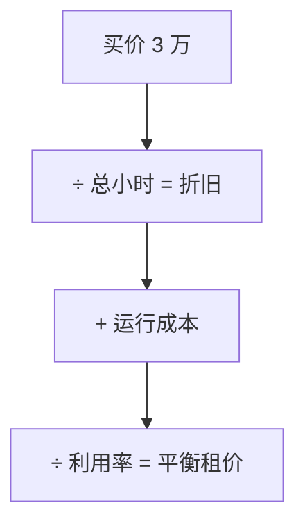

## Q
**GPU-hour 与 payback**｜考点 · 必会

一块 GPU 买入价 3 万美元，电力与机房每小时 0.5 美元，按 4 年折旧。每小时租价至少多少才不亏？回本要多久？

## A
**GPU-hour**：一块 GPU 运行一小时，是云上算力的计价单位。**Payback period（回本期）**：投入收回需要的时间。

**演算（假设数字）：**

| 项 | 计算 | 结果 |
|---|---|---|
| 年小时数 | 8760 | |
| 4 年总小时 | 8760 × 4 | 35,040 |
| 折旧每小时 | 30,000 ÷ 35,040 | 约 0.86 美元 |
| 运行成本每小时 | 给定 | 0.50 美元 |
| 盈亏平衡租价（利用率 100%） | 0.86 + 0.50 | 约 1.36 美元 |
| 利用率 70% 时 | 1.36 ÷ 0.7 | 约 1.94 美元 |

**回本期：** 若租价 2.50 美元、利用率 70%，每年收入 = 2.5 × 8760 × 0.7 ≈ 15,330，扣运行成本 0.5 × 8760 = 4,380，得净现金 ≈ 10,950，回本 ≈ 30000 ÷ 10950 ≈ 2.7 年。

**敏感点：** 利用率、折旧年限（折成 6 年则平衡租价变低）、租价随代际下降（Epoch：性能每美元年增 1.49 倍）。

**出处：** 通用单位经济学；Epoch AI Trends（性能每美元）；数字为演示用。
