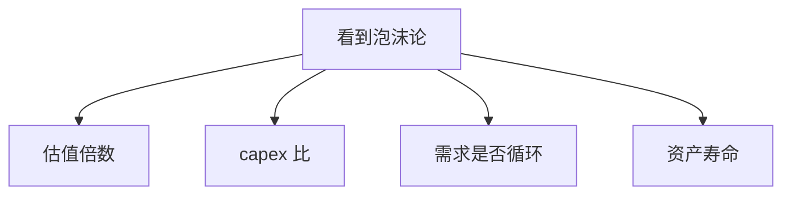

## Q
**Bubble 信号怎么读**｜怎么读 · 追问

有人拿 AI 与历史上的铁路、光纤泡沫比较。你用哪几个指标来比，哪些是真正的信号，哪些只是故事？

## A
**四个指标：**

| 指标 | 算法 | 读法 |
|---|---|---|
| Revenue multiple | 估值 ÷ 年收入 | 倍数高要增长兑现；要和增速一起看 |
| Capex-to-revenue | 资本开支 ÷ 收入 | 比值升高而收入没跟上，是压力信号 |
| 需求的真实性 | 终端付费收入 ÷ 供应商的投资 | 循环融资成分大时需求被高估 |
| 资产寿命 vs 融资期限 | 设备折旧年限 vs 债务期限 | 设备更快过时而债务更长，风险叠加 |

**与历史比较的两端：** 相同：基础设施先于需求建成，融资靠预期。不同：当下的主要买家（hyperscaler）有大量经营现金流；历史上铁路与光纤的买家多靠外部融资。是否同样，要对照上面四个指标，而不是靠类比。

**市场情绪的一例：** State of AI 2026 提到 2 月两周内软件股市值蒸发约 2850 亿美元（「SaaSpocalypse」），说明预期可以很快转向。

**不做：** 价格预测与买卖建议。

**核对日期：** 2026-11-21。

**出处：** State of AI Report 2026（stateof.ai）；指标定义为通用财务分析。
