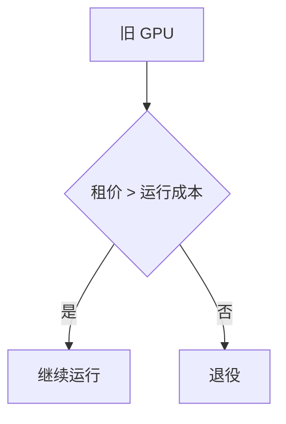

## Q
**旧卡值多少**｜怎么读 · 追问

有人说「GPU 只有两年寿命，云公司折旧 6 年是在做账」。另一个人说「旧卡会转去跑推理，仍然赚钱」。你用什么证据来裁决？

## A
**两种说法检验的是不同的量：**

| 说法 | 检验什么 | 去哪找证据 |
|---|---|---|
| 物理寿命 | 卡能不能用 | 供应商与客户的故障率数据（很少公开） |
| 经济寿命 | 继续用的收益是否超过电费与机位成本 | **GPU 租价**随代际的下降曲线 |

**经济寿命的判断：** 旧卡每小时租价 ≥ 电费 + 机架成本，就仍然值得开着。租价跌破这条线，才真正过期。

**可核对的三个公开点：**
1. 10-K 披露的 useful life 及其变动；
2. 第三方追踪的租价历史；
3. 二手市场与云厂商退役公告。

**注意：** 两种说法都可能对，取决于年份、芯片型号和负载。没有单一答案，要看租价曲线。

出处

通用成本分析方法；Epoch AI Trends（性能每美元年增 1.49 倍）。

