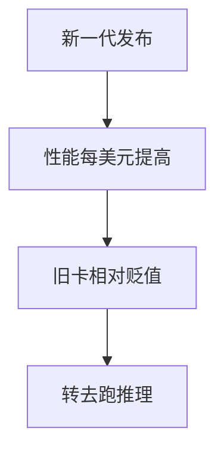

## Q
**Chip 代际与折旧**｜摘要 · 必会

新一代 GPU 性价比更高，旧卡还值多少钱？这对数据中心的账意味着什么？

## A
**数据：** Epoch AI 统计，AI 芯片的性能每美元自 2023 年起约每年提高 1.49 倍（以 2025 年美元计，90% 置信区间 1.36–1.66 倍），翻倍时间约 1.7 年；提升是跳跃式的，随新一代发布出现（Epoch AI Trends 页）。

**含义：**
- 同样的钱，两年后买的算力约多 2.2 倍（1.49²）。旧卡每单位算力的成本相对变高，价格上有下行压力。
- 旧卡仍能用：跑推理、跑小模型、跑不要求最新的任务；所以不是一夜归零，而是慢慢降级。
- **Residual value（残值）**：折旧期满后设备还值多少钱，是会计假设；乐观假设让利润更好看。

**怎么读：** 云公司的折旧年限（10-K 的 PP&E 附注）与芯片代际周期放在一起看：年限比代际更长，利润可能被高估。

**核对日期：** 2026-11-21。

**出处：** Epoch AI Trends（https://epoch.ai/trends）。
