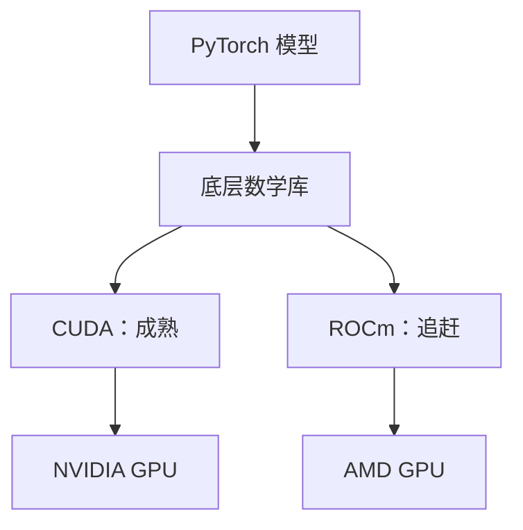

## Q
**CUDA · 为什么是护城河**｜摘要 · 必会

AMD 的芯片参数不差，为什么大多数 AI 团队仍默认买 NVIDIA？CUDA 锁住了什么？

## A
**CUDA** 是 NVIDIA 的并行计算平台和编程接口：开发者用它写在 GPU 上运行的程序（叫 kernel，GPU 上执行的一段小函数）。

**锁定来自三层：**

| 层 | 内容 | 换掉的代价 |
|---|---|---|
| 库 | cuDNN、cuBLAS 等优化好的底层数学库，框架（PyTorch 等）默认调用 | 要为新硬件重新实现和调优 |
| 工具 | 调试、性能分析、集群通信库 | 工程师要重新学 |
| 人与代码 | 多年积累的 kernel、开源项目、招聘市场 | 迁移期间的性能与稳定性风险 |

**替代路线：** AMD 的 **ROCm**（开放的软件栈，目标是兼容 CUDA 程序）；**编译器路线**（让框架生成适配不同芯片的 kernel，减少手写）。它们降低迁移成本，但不会让「最优性能需要手工调优」这件事消失。

**判断标准：** 看大客户是否在**生产环境**里跑非 NVIDIA 芯片的主要负载，而不是只做测试。

**出处：** 通用产业知识（CUDA / ROCm 的角色）；本卡不含数字。
