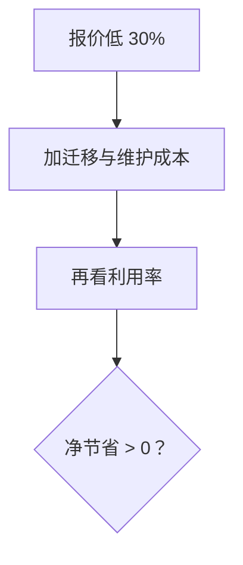

## Q
**迁移成本推演**｜考点 · 追问

你是一家公司的基础设施负责人，AMD 报价比 NVIDIA 低 30%。迁移要考虑的成本有哪些？什么条件下才划算？

## A
**账要算全：**

| 项 | 内容 |
|---|---|
| 一次性 | 工程师改写和调优 kernel、验证数值是否一致、改 CI 和监控 |
| 持续 | 两套栈并行维护；遇到问题社区答案少 |
| 隐性 | 同样的模型，利用率更低 → 实际每 token 成本未必低 |
| 收益 | 单价低 30%、供应多一个来源、对 NVIDIA 议价 |

**划算的条件（任一）：**
1. 规模大到节省的采购额远超工程投入；
2. 负载单一且稳定（例如固定的推理服务），调优一次反复用；
3. 供应受限，拿不到 NVIDIA 的货，没有别的选择。

**公式（演示）：** 节省 = 采购额 × 30% − 一次性迁移成本 − 持续维护成本 − 利用率下降造成的损失。

出处

通用成本分析方法；30% 为演示数字。

