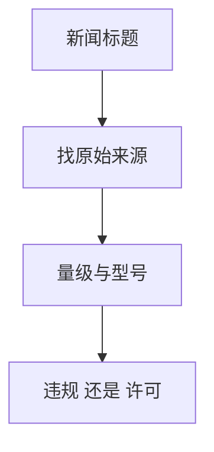

## Q
**走私与管制新闻怎么读**｜怎么读 · 必会

新闻说「某批受限 GPU 流入了中国」。你要核对什么，才不会被一条标题带跑？

## A
| 问题 | 为什么 |
|---|---|
| 来源是什么？法院文件、政府公告，还是匿名消息 | 官方文件有案号与日期，可追溯 |
| 数量是多少，占总量多大 | 几百块和几十万块是两件事 |
| 芯片是哪一型？属于哪个管制档 | 规则按性能阈值分档，不同档的合规路径不同 |
| 是违规，还是在许可框架内 | 2026-01 起部分芯片可逐案申请许可（BIS） |
| 谁受益于这个说法 | 呼吁加严或放宽的各方都有立场 |

**对财报的传导：** 管制变动直接进入公司利润表。NVIDIA 2026 财年有 45 亿美元与 H20 库存、采购承诺相关的费用；2027 财年第一季度指引不假设来自中国的 data center compute 收入（NVIDIA 财报）。

**出处：** BIS final rule（Federal Register 2026-01-15）；NVIDIA FY2026 10-K MD&A、Q4 FY2026 新闻稿。
