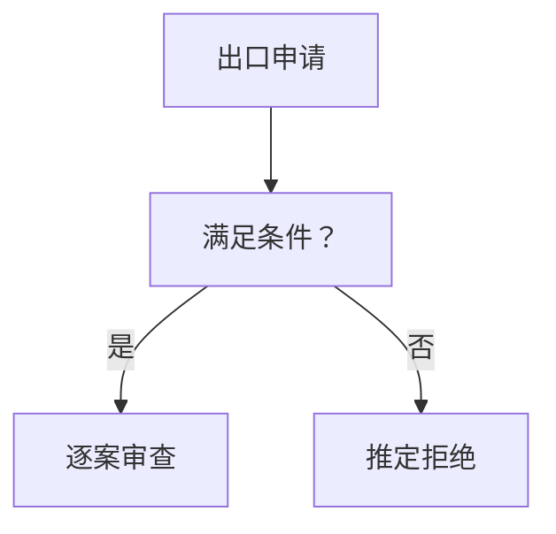

## Q
**出口管制 · 2026 年 1 月的规则**｜摘要 · 必会

美国的 AI 芯片出口管制是「禁止」还是「许可」？2026 年 1 月 BIS 的规则改了什么？

## A
**Export controls**：政府限制哪些芯片、卖给谁、需要什么许可。美国由 **BIS**（Bureau of Industry and Security，商务部工业与安全局）负责。

**2026-01-15 生效的 final rule（Federal Register）：** 向中国和澳门出口部分高级芯片，许可审查政策从「推定拒绝」改为「逐案审查」，但要满足条件：

| 条件 | 内容 |
|---|---|
| 范围 | TPP（总处理性能）低于 21,000 且显存带宽低于 6,500 GB/s 的芯片；规则点名 NVIDIA H200、AMD MI325X |
| 美国优先 | 不得延误美国订单，不得挤占本应供给美国客户的代工产能 |
| 数量上限 | 出口到中国和澳门的总量不超过同类产品美国国内出货量的 50% |
| 第三方测试 | 出口前由位于美国的独立实验室确认规格 |
| 用户限制 | 不得用于军事、核、导弹、化学生物武器等最终用途；收货方需有客户审查（KYC）程序 |

**不变的：** 经转口或在境内转手的情形，仍然推定拒绝。

**核对日期：** 2026-11-21；规则可能被后续修订。

出处

Federal Register Vol. 91, No. 10（2026-01-15），BIS final rule RIN 0694-AK43（govinfo.gov）。

