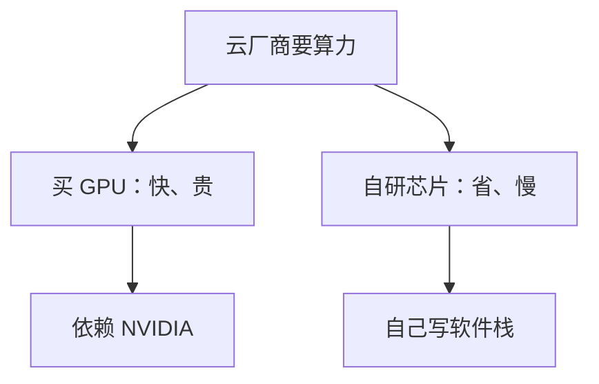

## Q
**GPU 与 custom silicon**｜摘要 · 必会

AI 算力不只有 NVIDIA 的 GPU。AMD、Google TPU、Amazon Trainium 各是什么？通用芯片和定制芯片（custom silicon）之间是什么取舍？

## A
**先定义：**
- **GPU**：最初为图形设计，擅长大批量并行的矩阵乘法，所以成了 AI 的主力。NVIDIA 是最大的供应商，AMD 是主要对手。
- **Accelerator（加速器）**：专门加速 AI 计算的芯片统称，GPU 是其中一种。
- **TPU**：Google 自己设计的 AI 加速器；**Trainium**：Amazon 自己设计的 AI 加速器。这类由云厂商自研的叫 custom silicon（定制芯片）。

| | 通用 GPU | 定制芯片 |
|---|---|---|
| 灵活性 | 什么模型都能跑，软件生态成熟 | 针对云厂商自己的负载优化 |
| 成本 | 付 NVIDIA 的毛利（2026 财年 GAAP 毛利率 71.1%，NVIDIA 10-K） | 省掉这部分，但要付设计与软件成本 |
| 风险 | 供应紧张，议价弱 | 生态小，客户要为迁移买单 |
| 谁买 | 所有人 | 主要是自家和少数大客户 |

**怎么读份额新闻：** 区分**出货量**（芯片数）、**收入**、**算力总量**；自研芯片多是自用，不进外部市场份额统计。

**出处：** NVIDIA FY2026 10-K MD&A（毛利率）；GPU / TPU / Trainium 的定义为通用产业知识。
