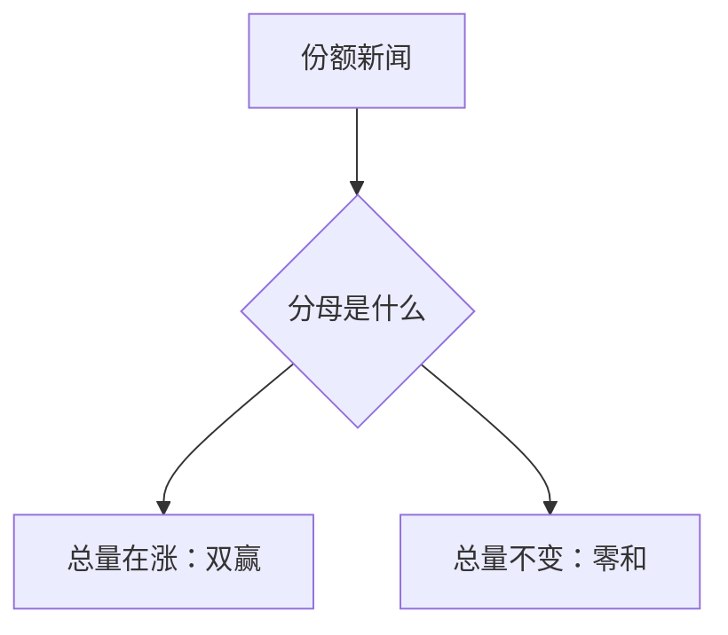

## Q
**份额新闻怎么读**｜怎么读 · 追问

报道说「某云厂商的自研芯片已占其新增算力的一半」。要核对哪三个问题，才不会把它读成「NVIDIA 要失势」？

## A
| # | 问题 | 为什么 |
|---|---|---|
| 1 | 分母是什么？新增算力、总算力、还是花费？ | 新增和存量差别很大；按花费还是按芯片数也不同 |
| 2 | 自研芯片跑的是谁的负载？ | 自家模型（便宜、可控）还是外部客户（要靠生态） |
| 3 | 总量有没有变大？ | 如果总需求在涨，两边可以同时增长；NVIDIA 2026 财年 data center 收入 +68%（FY2026 10-K） |

**一个简单的核对：** 找云厂商的 capex 里有多少付给了 NVIDIA（NVIDIA 的客户集中度附注：一个直接客户占 2026 财年收入 22%）。自研再多，只要这笔钱还在涨，就没有「失势」。

出处

NVIDIA FY2026 10-K（经 MarketScreener 转载页核对）。

