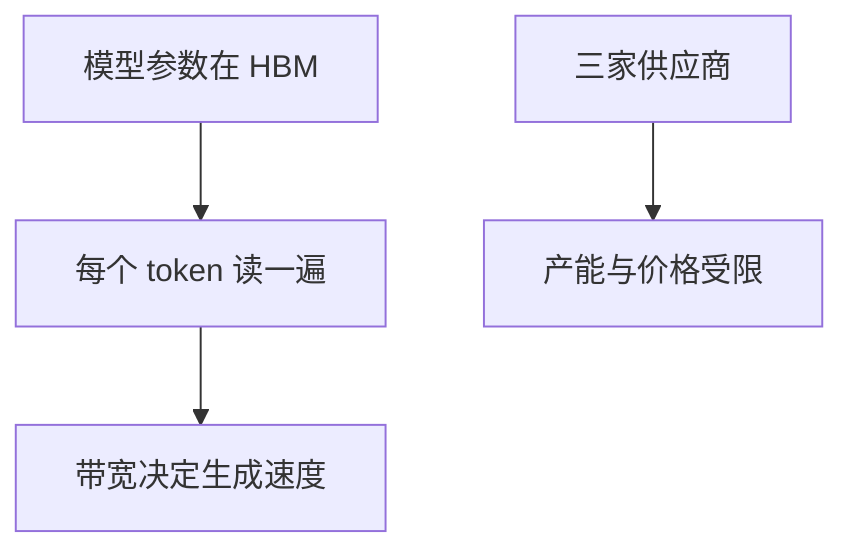

## Q
**HBM · 为什么是瓶颈**｜摘要 · 必会

GPU 的计算能力每代都在涨，为什么业内说瓶颈常常是 HBM？HBM 是什么，谁在做？

## A
**HBM（High Bandwidth Memory）**：把多层 DRAM（内存芯片）垂直堆叠，紧贴在计算芯片旁边，数据通路很宽，所以带宽（每秒能搬多少数据）远高于普通内存。

**为什么影响推理速度：** 模型逐个 token 生成，每生成一个 token 都要把模型的参数从显存读一遍。

**演算（假设数字）：** 700 亿参数、每个参数 2 字节 = 140 GB；若显存带宽为 3 TB/s，读一遍至少 140 ÷ 3000 ≈ 47 毫秒，即每秒最多约 21 个 token（单请求）。算力再强也快不过带宽。

**供给端：**
- 只有三家做：SK hynix、Samsung、Micron（TrendForce 2026-08）。
- 2026 年的看点是 HBM4 的认证进度：Samsung 报道称 HBM4 良率从不到 60% 升到 80%，目标年底 HBM 份额约 38%（TrendForce 报道，2026-08-10）。
- TrendForce 预计 HBM 供应商的定价权至少持续到 2027 年；2027 年 HBM 位出货预计增长 50%–60%，仍低于需求增速。

**核对日期：** 2026-11-21；份额为报道估计，口径随厂商和统计方式不同。

**出处：** TrendForce News 2026-08-10（trendforce.com/news/2026/08/10/news-samsungs-hbm4-yield-reportedly-hits-80）。
