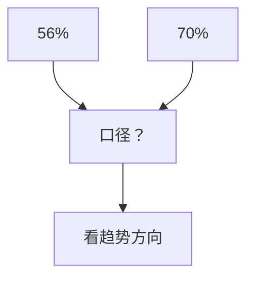

## Q
**HBM 份额新闻**｜怎么读 · 追问

两篇报道，一篇说 SK hynix 的 HBM 份额「56%」，另一篇说「约 70%」。它们能同时是对的吗？

## A
**能。** 数字的口径不同：

| 可能的差别 | 例子 |
|---|---|
| 指标 | 收入份额 vs 位（bit）出货份额 |
| 产品代 | 所有 HBM vs 只算 HBM4 |
| 时间 | 全年 vs 某个季度 |
| 客户范围 | 全市场 vs 只算某个大客户的采购 |

**读法三步：** ① 找口径句（share of what, which period）；② 找原始来源是调研机构、公司文件还是匿名消息；③ 看趋势方向（谁在涨）而不是绝对数。

2026 年的实际趋势（TrendForce 2026-08）：Samsung 的 HBM4 份额预期上调，SK hynix 预期被下调，Micron 因 HBM4 暴露有限份额较稳。

**核对日期：** 2026-11-21。

出处

TrendForce News 2026-08-10；份额数字本身未采用。

