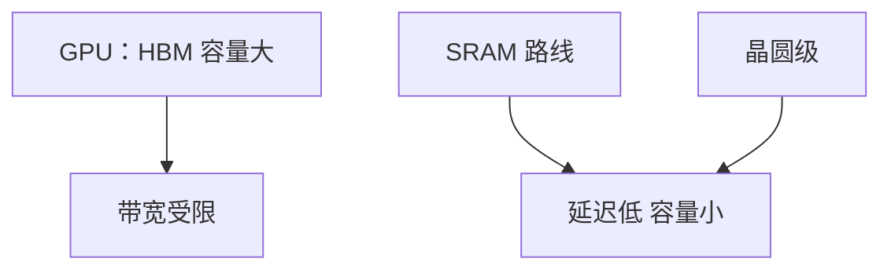

## Q
**Inference 芯片的新路线**｜摘要 · 追问

一些新进入者用片上 SRAM 或晶圆级芯片来做推理加速。它们切入的是哪一段延迟与成本曲线？

## A
**回忆：** 生成每个 token 要把参数从显存读一遍，速度受带宽限制（见 HBM 一卡）。

**两条路线：**

| 路线 | 做法 | 取舍 |
|---|---|---|
| **片上 SRAM** | 把参数放进芯片内的 SRAM（读取极快但容量小、占面积） | 单个请求的延迟很低；大模型要用很多芯片拼 |
| **晶圆级（wafer-scale）** | 用一整片晶圆做一块巨大的芯片，片上存储多、片内带宽高 | 延迟低；制造、供电与散热难度大，成本高 |

**切入点：** 它们不去争夺大批量训练，而是争**低延迟的推理**：每秒 token 更多、响应更快的场景（实时对话、agent 循环）。

**要问的：** 每百万 token 的总成本比 GPU 低还是高？能跑多大的模型？软件生态如何（回顾 CUDA 一卡）？

出处

通用硬件取舍；本卡不含数字，llm-inference 域有技术细节。

