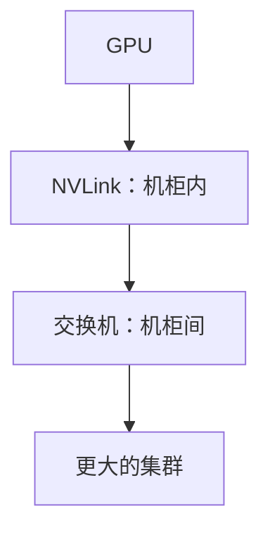

## Q
**Interconnect 与 networking**｜摘要 · 追问

为什么「集群规模靠网络」？NVLink、InfiniBand、Ethernet 各在哪一层？

## A
**问题：** 训练一个大模型要几千到几万块 GPU 协同；每一步它们都要交换数据（梯度、激活值）。网络慢了，GPU 就空等，算力被浪费。

| 层 | 范围 | 例子 |
|---|---|---|
| 芯片间（scale-up） | 同一机柜内 GPU 互联，带宽最高 | NVLink（NVIDIA 的专有互联） |
| 机柜间（scale-out） | 集群内跨机柜 | InfiniBand（高性能计算常用的网络）、Ethernet（通用网络，AI 场景在升级） |
| 光模块与交换机 | 用光纤把交换机连起来的部件 | 供应商也是 AI 建设的受益者 |

**数据点：** NVIDIA 2026 财年 10-K：data center networking 收入增长 142%，computing 增长 59%——网络的增长快于计算，说明集群在变大。

**怎么读：** 在财报里看 networking 与 compute 的相对增速；在新闻里分清专有互联（锁定）与开放以太网（多供应商）。

出处

NVIDIA FY2026 10-K MD&A（经 MarketScreener 转载页）。

