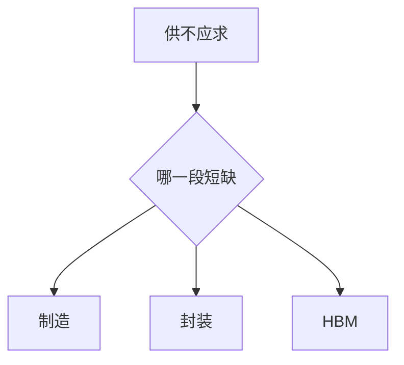

## Q
**瓶颈定位**｜考点 · 追问

某季度 NVIDIA 说需求超过供给，产能不足。如果是 CoWoS 不够，和如果是 HBM 不够，你从财报或新闻里分别能看到什么不同的信号？

## A
| 信号 | 偏 CoWoS | 偏 HBM |
|---|---|---|
| 谁在说 | TSMC 的资本开支与扩产计划 | SK hynix、Samsung、Micron 的 HBM 售罄与涨价消息 |
| 影响哪些产品 | 所有用 CoWoS 的加速卡 | 用更高容量 HBM 的新一代卡先受限 |
| 长期合同 | 对产能的预订与预付 | HBM 按年签量价（TrendForce 称供应商定价权持续到 2027） |
| NVIDIA 财报 | 采购承诺、预付款增加（10-K：制造周期可能超过十二个月，可能下不可撤销订单、付溢价和预付款） | 毛利成本上升 |

**判断规则：** 供给两头不对称时，出货被**最短的那块板**决定；扩一头不能立刻增加出货。

**出处：** NVIDIA FY2026 10-K MD&A（lead time 与不可撤销订单，经 MarketScreener 转载页）；TrendForce News 2026-08-10。
