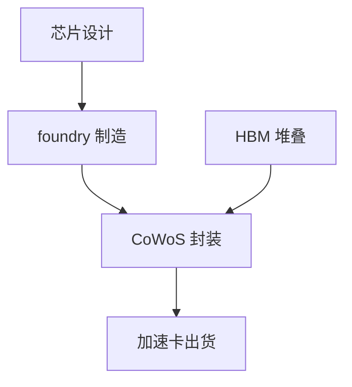

## Q
**CoWoS 与 foundry**｜摘要 · 必会

一块 AI 加速卡里，TSMC 做了什么？CoWoS 是什么，为什么它的产能会决定一年能出多少卡？

## A
**两步制造：**

| 步骤 | 做什么 | 瓶颈在哪 |
|---|---|---|
| 1 制造（foundry） | 在硅片（wafer）上刻出计算芯片；最先进制程只有极少数厂能做，TSMC 是最大的一家 | 先进制程产能集中 |
| 2 封装（packaging） | **CoWoS**（Chip-on-Wafer-on-Substrate，TSMC 的先进封装技术）：把计算芯片和多颗 HBM 并排放在一块中介层上，再装到基板上 | 专用产线，扩产需要设备与时间 |

**含义：** 芯片设计公司自己不制造；谁订到先进制程和 CoWoS 产能，谁就能出货。HBM 和计算芯片必须在同一次封装里合体，所以 HBM 供应和 CoWoS 产能互相卡着。

**怎么读：** 看到「芯片短缺」，先问短的是**制造**、**封装**还是 **HBM**，三者的解法和周期不同。

**出处：** 通用产业知识（CoWoS 的作用）；TrendForce 2026 HBM 报道（HBM 与封装在同一产线汇合）。
