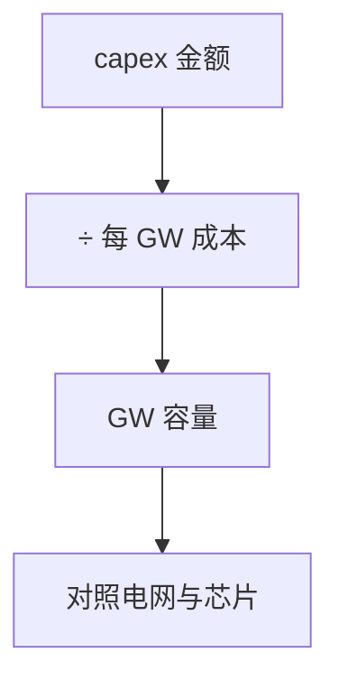

## Q
**Capex 换成吉瓦**｜考点 · 追问

用 Epoch AI 的估计，把「几千亿美元 capex」换算成「多少吉瓦（GW）的 AI 机房」。这样做有什么用，局限在哪？

## A
**GW（吉瓦）**：功率单位，1 GW = 100 万千瓦；数据中心常用 IT 功率（机房里设备耗电）衡量规模。

**Epoch AI：** 1 GW（IT 功率）的 AI 数据中心前期资本开支约 380 亿美元；GW 级数据中心建设时间约 2.1 年（90% 置信区间 1–3.6 年）。

**换算（演示）：** 若指引总额 7330 亿美元全部用于 AI 机房 ≈ 7330 ÷ 38 ≈ 19 GW。

**用处：** 把金额换成物理量，才能和电网、土地、芯片出货对照，看有没有可能建得出来。

**局限：**
- 并非全部 capex 都是 AI；
- 380 亿是估计，且随芯片价格变化；
- 建设时间 2.1 年说明今天的 capex 对应 2–3 年后的容量。

出处

Epoch AI Trends（epoch.ai/trends，2026-11 核对）；State of AI Report 2026 首页。

