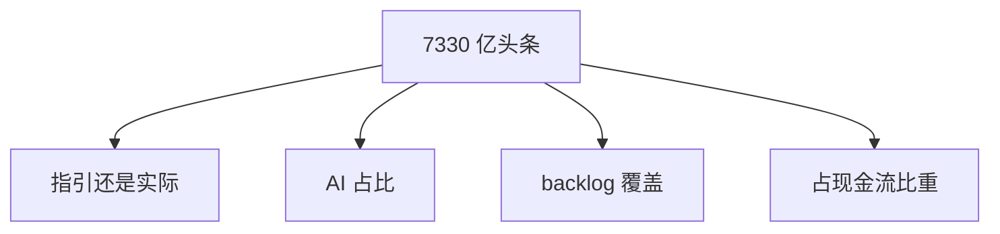

## Q
**Capex 头条怎么读**｜怎么读 · 必会

头条说「四大云厂商 2026 年资本开支将达约 7330 亿美元」。要把它变成能判断的信息，你要追问哪四件事？

## A
**事实：** State of AI Report 2026（Air Street Capital，2026-10）称四家美国 hyperscaler 对 2026 年的 capex 指引合计约 7330 亿美元。

**这个数字是什么：** guidance（管理层给的预期区间，不是已发生的支出），四家加总，口径取决于各家如何计入融资租赁。

| # | 追问 | 为什么 |
|---|---|---|
| 1 | 是指引还是实际？ | 指引会上调或下调；看上一年指引与实际的差 |
| 2 | 多少是 AI？ | capex 含土地、厂房、网络与传统云业务；要看分部披露 |
| 3 | 多少已经签了合同？ | 看 backlog（已签约未确认收入）能否覆盖 |
| 4 | 与现金流比如何？ | 占经营现金流的比重高，说明靠借债或压低回购来支撑 |

**核对日期：** 2026-11-21。口径与最新数请直接读各家 10-Q。

**出处：** State of AI Report 2026 首页（stateof.ai）。
