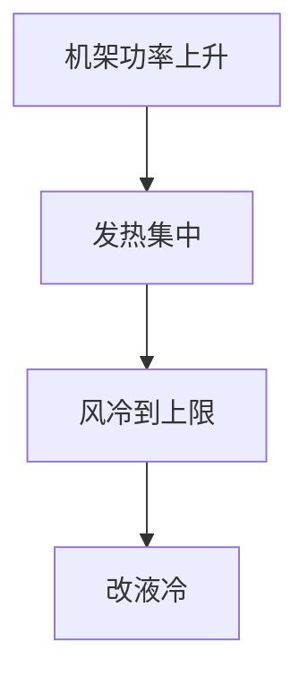

## Q
**机架功率与 liquid cooling**｜摘要 · 追问

AI 机架的功率密度上升后，为什么风冷不够了？PUE 在其中的角色是什么？

## A
**物理：** 芯片耗的电几乎全变成热。一个机架里放的 GPU 越多，单位面积的发热越高；空气带走热量的能力有限。

| 方式 | 做法 | 取舍 |
|---|---|---|
| 风冷 | 风扇与冷通道 | 成熟便宜，机架功率上限低 |
| **Liquid cooling（液冷）** | 冷却液直接流过芯片冷板或整机浸入 | 能支持更高密度；管路、漏液、改造成本 |

**PUE**（总用电 ÷ IT 用电）衡量制冷等额外开销；液冷通常能让它更接近 1，但 PUE 不看芯片本身效率，只是设施效率。

**对工程的影响：** 机房楼板承重、管路、新建 vs 改造、运维技能都变了。

**出处：** 通用数据中心工程知识；PUE 定义见 Power 一卡。
