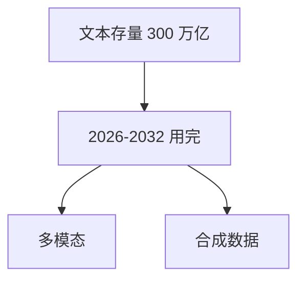

## Q
**Data wall**｜摘要 · 追问

「互联网上的文字快被用完了」是真的吗？Epoch 怎么估计，synthetic data 能补多少？

## A
**Epoch AI 的估计（论文）：** 公开人类文本的有效存量约 300 万亿 token（90% 区间 100–1000 万亿；只算质量过滤后的数据，允许多轮训练）。按此，充分利用的时间 80% 区间为 2026–2032 年。

| 因素 | 效果 |
|---|---|
| 过度训练（用比算力最优更多的数据） | 5 倍过度训练：2027 年用完；Llama 3-70B 过度训练约 10 倍 |
| 多模态（图像、视频） | 不在这个文本存量里，是额外来源 |
| Synthetic data（模型生成的训练数据） | 论文称「尚未被很好理解」；目前在数学与代码等窄领域确实有帮助 |

**读法：** 这是 2024 年的论文估计；作者上一版（2022）曾预测高质量文本会在 2024 年用完，说明这类估计会随方法修正。

**核对日期：** 2026-11-21。

出处

Epoch AI, Will we run out of data?（epoch.ai/blog/will-we-run-out-of-data-limits-of-llm-scaling-based-on-human-generated-data）。

