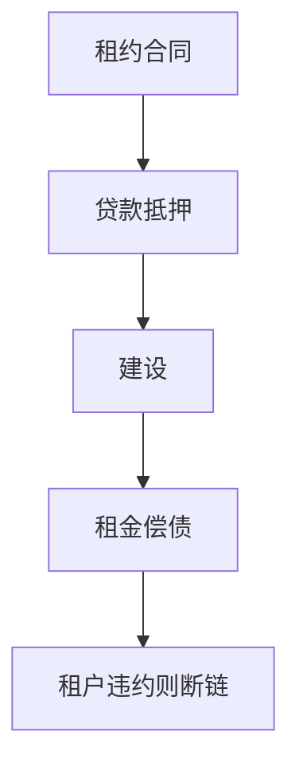

## Q
**Data center 怎么融资**｜摘要 · 追问

建一个 GW 级数据中心要几百亿美元。钱从哪里来，哪里最脆弱？

## A
**规模：** Epoch AI：1 GW AI 数据中心前期资本开支约 380 亿美元，建设约 2.1 年。

| 方式 | 内容 | 脆弱点 |
|---|---|---|
| 自有现金流 | hyperscaler 用经营现金流 | 现金流下降时压缩回购或举债 |
| 租赁 | 建设方建好后长期租给云或 lab | 承租方违约；合同期限短于设备寿命 |
| 表外融资 | 通过独立项目公司持有资产，母公司不在表内列债务 | 担保与承诺在脚注里，需要读 10-K 的 commitments |
| 私募信贷 | 基金与机构放贷，以租约为抵押 | 利率与再融资 |

**State of AI 2026：** NVIDIA 与六家金融机构的合作目标是撬动 5000 亿美元以上的 AI 基础设施资金；CoreWeave 到 8 月已签约 4.2 GW。

**脆弱点一句话：** 债务期限和租约期限要长于设备更新周期，否则是错配。

**核对日期：** 2026-11-21。

**出处：** Epoch AI Trends；State of AI Report 2026（stateof.ai）。
