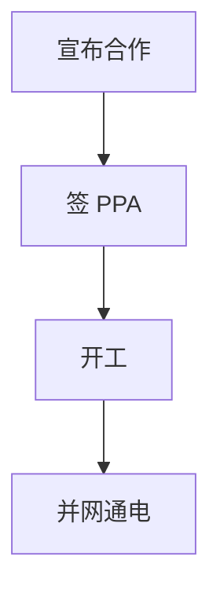

## Q
**能源路线怎么比**｜怎么读 · 追问

数据中心运营者宣布「与核电站签约」「自建燃气发电」「买风光电」。比较这些路线时，用哪几个维度？

## A
| 维度 | 问什么 |
|---|---|
| 交付时间 | 现有电站的购电协议几个月；新建燃气厂与新建核电要按年计，且要看设备交付 |
| 成本 | 每度电价格，和是否 24 小时稳定供电 |
| 稳定性 | 风光随天气波动，要配储能或备用电源；核电和燃气稳定 |
| 并网 | 自备电源能不能绕开电网排队（behind the meter，表后） |
| 排放与政策 | 公司的减排承诺、地方许可 |

**读新闻：** 区分**意向书**、**购电协议（PPA）**、**已开工**、**已通电**；每一档的实现概率差别很大。

**判断：** 对近几年的容量，最快的是现有电网与现有电源的合同；新建核电对应更远的未来。这是一般规律，具体项目要看公告。

**出处：** 通用能源项目阶段划分；Epoch AI Trends（GW 级机房建设约 2.1 年）。
