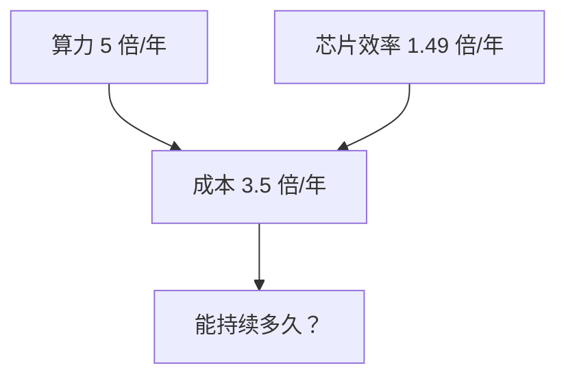

## Q
**训练算力的增长**｜摘要 · 必会

「前沿模型的训练算力每年增长约多少倍？」把 Epoch AI 的数字、口径和置信区间说清。

## A
**先定义：** **FLOP**（浮点运算次数）：训练一个模型一共做了多少次基本计算，是「训练算力」的单位。

**Epoch AI（Trends 页，2026-11 核对）：**

| 指标 | 增速 | 翻倍时间 | 90% 区间 | 起点 |
|---|---|---|---|---|
| 前沿语言模型训练算力 | 5 倍/年 | 5.2 个月 | 4–6 倍 | 2020 年起 |
| 前沿语言模型训练成本 | 3.5 倍/年 | 7 个月 | 2.8–4.4 倍 | 2020 年起 |
| AI 芯片性能每美元 | 1.49 倍/年 | 1.7 年 | 1.36–1.66 倍 | 2023 年起 |

另有：前五名模型 2020 年以来增长约 10,000 倍。

**为什么算力涨得比成本快：** 芯片性能每美元在涨，吸收了一部分。

**读法：** 这是历史拟合，不是预测；每个数都有区间和起点。

**出处：** Epoch AI Trends（https://epoch.ai/trends）；AI Index 2025 称训练算力每 5 个月翻倍（与上表一致）。
