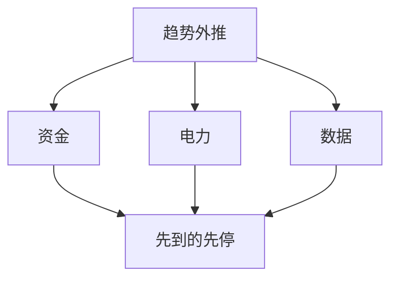

## Q
**趋势能延续多久**｜考点 · 追问

训练成本每年涨 3.5 倍。如果今天前沿训练一次要 10 亿美元，按这个速度几年后会超过一个大国的年度 GDP 的 1%？先算，再说出至少三个约束。

## A
**演算（假设起点）：** 10 亿美元 × 3.5ⁿ。n=2：约 123 亿；n=3：约 429 亿；n=4：约 1500 亿。成本很快达到千亿美元量级，不可能永远延续。

**三类约束：**

| 约束 | 内容 |
|---|---|
| 资金 | 单次训练的价格要有收入支撑；见 lab 收入与融资两卡 |
| 电力与建设 | GW 级机房约 2.1 年才能建成（Epoch）；电网要排队 |
| 数据 | 公共人类文本的存量估计约 300 万亿 token（Epoch，80% 区间 2026–2032 年耗尽） |

**读法：** 外推要写上「在哪个条件下」；趋势停止常常是因为某个约束先到。

**出处：** Epoch AI Trends；Epoch AI, Will we run out of data?（epoch.ai/blog/will-we-run-out-of-data-limits-of-llm-scaling-based-on-human-generated-data）。
