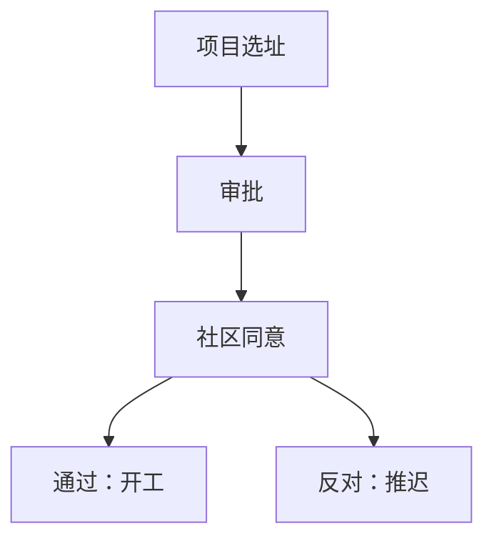

## Q
**Local opposition 影响进度吗**｜摘要 · 追问

社区反对数据中心是个别新闻，还是已经影响到建设进度？有哪些数据？

## A
**数据（State of AI Report 2026）：**

| 指标 | 数字 |
|---|---|
| Gallup（2026 年 3 月）：反对在本地建 AI 数据中心的美国人 | 71%（对比反对本地建核电站的 53%） |
| Data Center Watch（2026 年第二季度） | 至少 45 个项目、计划投资近 680 亿美元被本地反对阻止或推迟 |

**反对的常见理由：** 用水、用电与电价、土地与噪声、税收减免。

**含义：** 审批和并网之外，**社区同意**成了新的前置条件。State of AI 称本地反对已经在决定哪些项目能推进。

**读法：** 调查是态度，被阻止的项目数是行为；两者不同。项目总数不明时，45 个的占比无法判断，要找分母。

**核对日期：** 2026-11-21。

出处

State of AI Report 2026（stateof.ai）。

