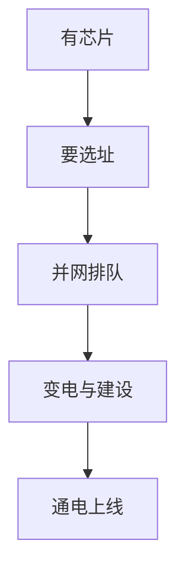

## Q
**Power 是新瓶颈**｜摘要 · 必会

为什么业内说 AI 扩张的瓶颈正在从芯片转向电力？电力比芯片难扩在哪？

## A
**规模：** Epoch AI 称最大的 AI 数据中心正接近 1 GW；AI Index 2025：训练算力每 5 个月翻倍，训练耗电每年翻倍。

**为什么难扩：**

| 环节 | 芯片 | 电力 |
|---|---|---|
| 谁来扩 | 少数公司能被订单拉动，扩产靠资本 | 电网运营商、设备商、监管，节奏由多方决定 |
| 链条 | 下单、制造、封装、交付 | 选址、并网申请（interconnection，排队接入电网）、审批、变电设备、建设 |
| 时间 | 以季度计 | 以年计：GW 级机房建设约 2.1 年（Epoch） |
| 可替代性 | 可以换型号 | 电要在哪就在哪，不能运输 |

**含义：** 芯片订单可以快速增加，电力的上线节奏决定它们什么时候真的开始干活。

**核对日期：** 2026-11-21。

出处

Epoch AI Trends；Stanford HAI AI Index 2025。

