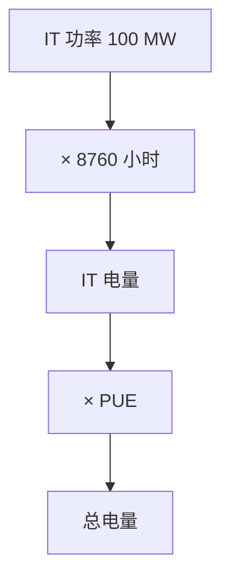

## Q
**一座机房要多少电**｜考点 · 追问

一个 100 MW 的 AI 机房，每年大约耗多少电量（MWh）？为什么 PUE 会让这个数更大？

## A
**先定义：** MW = 功率（瞬时），MWh = 电量（功率 × 时间）。**PUE**（Power Usage Effectiveness）= 机房总用电 ÷ IT 设备用电，反映制冷等额外开销，1.0 是理想值。

**演算（假设数字）：** IT 功率 100 MW，全年满载 8760 小时：
- IT 电量 = 100 × 8760 = 876,000 MWh；
- 若 PUE = 1.2，总电量 = 876,000 × 1.2 = 1,051,200 MWh。

| 项 | 数值 |
|---|---|
| IT 负载 | 100 MW |
| PUE | 1.2 |
| 全年总电量 | 约 105 万 MWh |

**读新闻时：** 要分清 MW（容量）和 MWh（电量）、IT 功率和总功率、已通电和已签约。

**出处：** 通用单位换算；数字为演示用。
