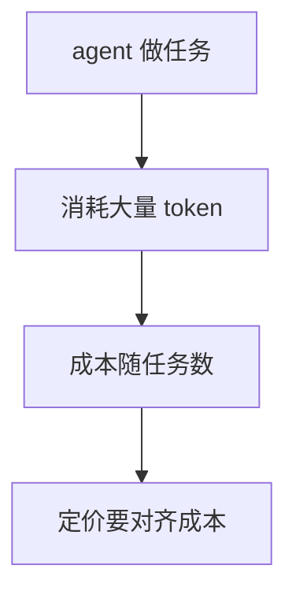

## Q
**Agents 与 AI-native 公司的 economics**｜摘要 · 追问

agent 产品为什么在尝试按结果收费，而不是按席位（每人每月）收费？AI-native 公司与原有软件公司增长有何不同？

## A
**席位定价的问题：** AI agent 可以替代一部分人的工作，若按席位收费，卖得越成功席位越少。

| 定价 | 收入随什么走 | 风险 |
|---|---|---|
| 按席位 | 人头 | agent 替代人头时收入萎缩 |
| 按用量 | token 或任务数 | 价格下降 |
| 按结果 | 解决的工单或完成的任务 | 结果难以定义，争议多 |

**增长数据（State of AI 2026，Standard Metrics 初步，Q2）：** 75 分位同比增速，100 万至 2000 万美元 ARR：AI-native 256%，AI-enabled 90%；2000 万美元以上：172% 对 53%。

**成本端：** agent 一次任务会反复调用模型，token 用量远高于聊天；毛利取决于每个任务的推理成本与定价的差。

**核对日期：** 2026-11-21。

出处

State of AI Report 2026（stateof.ai）。

