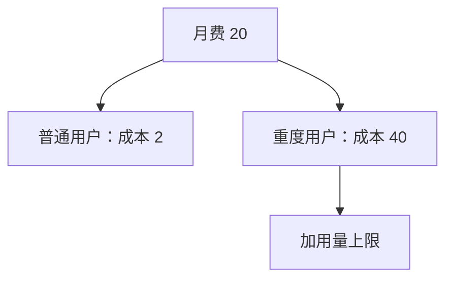

## Q
**订阅毛利推演**｜考点 · 追问

一款编程工具月费 20 美元。普通用户每月用 2 美元推理，重度用户用 40 美元。重度用户占 10% 时，平均毛利是多少？该怎么改定价？

## A
**演算（假设数字）：**
- 平均成本 = 0.9 × 2 + 0.1 × 40 = 5.8 美元
- 平均毛利 = (20 − 5.8) ÷ 20 = 71%
- 重度用户单人毛利 = (20 − 40) ÷ 20 = −100%

**结论：** 平均看着健康，但重度用户每人每月亏 20 美元；若重度占比到 30%，成本 = 0.7 × 2 + 0.3 × 40 = 13.4，毛利降到 33%。

**定价改法：**

| 方法 | 效果 |
|---|---|
| 设用量上限，超出按量计费 | 成本和收入对齐 |
| 分档位（20 美元、200 美元） | 重度用户自选高档 |
| 简单请求走小模型 | 降低单位成本 |

出处

通用单位经济学演算；数字为演示用。

