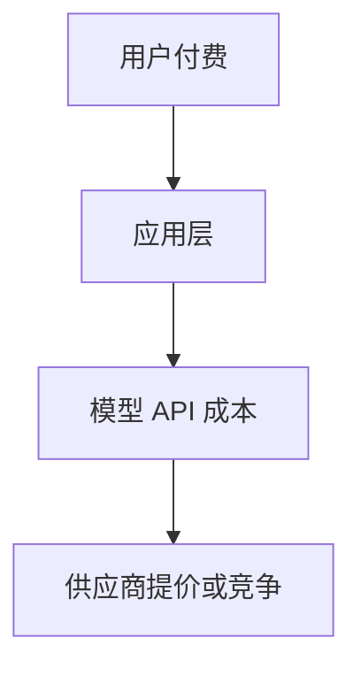

## Q
**应用层的利润被谁吃掉**｜摘要 · 必会

一家 AI 应用公司把模型 API 包成产品卖给用户。它的毛利会被哪几个方向挤压？

## A
**三个压力：**

| 压力 | 机制 |
|---|---|
| 模型供应商提价 | 应用的主要成本是 API；供应商换价目表，毛利直接变动 |
| 供应商自己做应用 | 模型公司推出同类产品，成为竞争对手，还掌握用量数据 |
| 用户用得越多越亏 | 订阅制固定价格，重度用户的推理成本超过月费 |

**对冲方式：**
- 多模型路由（不同难度的请求用不同价格的模型）；
- 按用量或按结果定价，让收入随成本走；
- 沉淀模型公司拿不到的东西：工作流集成、专有数据、企业合同。

**State of AI 2026（Standard Metrics 初步数据）：** 年收入 100 万至 2000 万美元的公司，75 分位的同比增速：AI-native 256%，AI-enabled（原有产品加 AI 功能）90%；2000 万美元以上：172% 对 53%。增长不等于利润，但说明新公司在抢份额。

**核对日期：** 2026-11-21。

出处

State of AI Report 2026（stateof.ai）。

