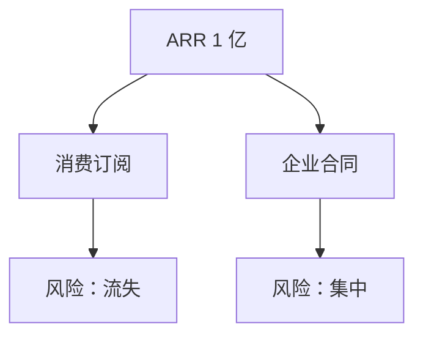

## Q
**留存与获客**｜考点 · 追问

两家公司的 ARR（annual recurring revenue，年度经常性收入）同样是 1 亿美元，一家靠 100 万用户的每月 8 美元订阅，一家靠 500 家企业的年度合同。哪家风险更大，你要问什么？

## A
**演算：** 100 万 × 8 × 12 = 9600 万美元；500 家 × 20 万 = 1 亿美元（假设每家 20 万）。

| 要问的 | 消费订阅 | 企业合同 |
|---|---|---|
| Churn（流失率）：每月多少人退订 | 高，用户随时取消 | 低，合同到期才续 |
| 获客成本 | 低单价，靠产品增长 | 高，靠销售 |
| 集中度 | 分散 | 前 10 大客户占比 |
| 收入的真实性 | 看活跃用户 | 看是否已签约、是否已开票 |
| 毛利 | 重度用户成本高 | 用量大客户可议价 |

出处

通用 SaaS 指标定义；数字为演示用。

