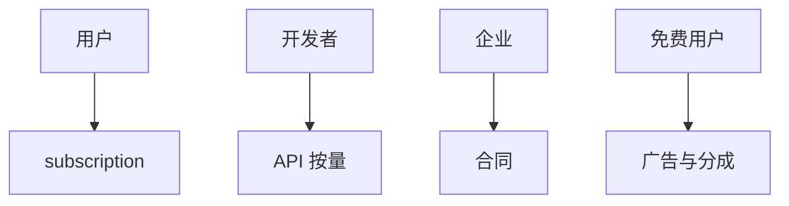

## Q
**Business model 四类**｜摘要 · 必会

模型公司靠什么赚钱？subscription、usage-based API、enterprise、ads 与 revenue share 各是怎么收钱的，各自风险在哪？

## A
| 模式 | 怎么收 | 优点 | 风险 |
|---|---|---|---|
| **Subscription** | 用户按月付固定费（如 20 美元） | 收入可预测 | 重度用户成本高于月费，毛利被挤 |
| **Usage-based API** | 开发者按 token 付费 | 收入随用量增长 | 价格持续下降；开发者可换供应商 |
| **Enterprise** | 签年度合同，按席位或用量 | 金额大、留存高 | 销售周期长，客户要求定制与安全合规 |
| **Ads / revenue share** | 广告；或与平台、云分成 | 免费用户也能变现 | 影响用户信任；分成依赖平台 |

**一个数据点：** Anthropic Economic Index（2026-01，样本为 2025-11-13 至 11-20）：API 上约四分之三的交互是自动化（automation），Claude.ai 上不到一半；API 里 74% 是工作用途，Claude.ai 为 46%。说明不同入口的用户行为不同，商业模式也不同。

**怎么读收入占比：** 找官方披露（财报、公司博客）；媒体估计要标明来源。

**核对日期：** 2026-11-21。

出处

Anthropic Economic Index: Economic Primitives（anthropic.com/research/anthropic-economic-index-january-2026-report）。

