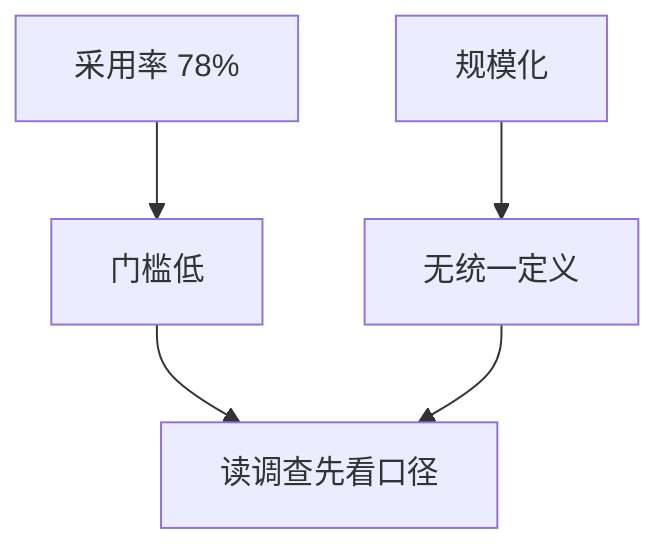

## Q
**企业采用的证据**｜摘要 · 必会

「78% 的企业已经在用 AI」和「大多数试点没有规模化」能同时成立吗？分别是怎么测的？

## A
**能同时成立：** 两个数问的不是同一件事。

| 数 | 来源 | 问法 |
|---|---|---|
| 78% 的组织在 2024 年报告使用 AI（上一年为 55%） | Stanford AI Index 2025 | 组织是否在至少一个业务环节用了 AI |
| 「试点多、规模化少」 | 各家咨询与调研机构的说法 | 是否从试点走到大规模部署，是否带来回报 |

**口径差别：**
- 「用了」的门槛很低：一个团队试用也算。
- 「规模化」没有统一定义；不同调查的阈值不一样。
- 样本偏差：自愿填问卷的人，更可能是对 AI 感兴趣的人；自报的回报不等于审计过的回报。

**用行为数据交叉：** Anthropic Economic Index（2026-01）显示 API 上约四分之三的交互是 automation，说明已有企业把任务整段交给模型；这类用量数据不依赖问卷。

**核对日期：** 2026-11-21。

**出处：** Stanford HAI, AI Index Report 2025；Anthropic Economic Index（2026-01）。
