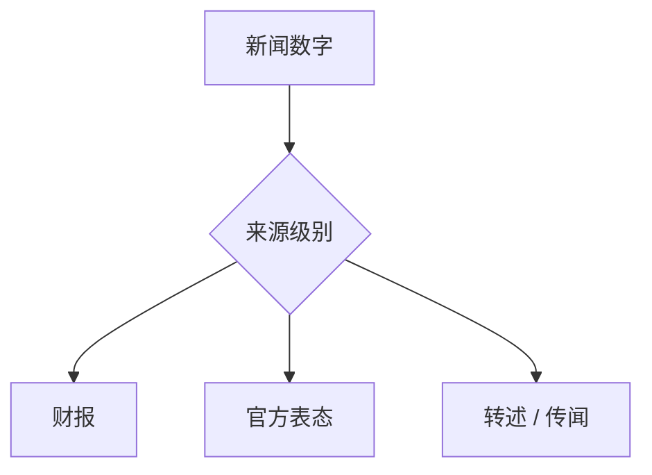

## Q
**Lab 收入数据怎么读**｜怎么读 · 必会

新闻写「某 lab 年化收入达到 X 亿美元，估值 Y 亿美元」。X 和 Y 各是什么？可信度怎么分级？

## A
**两个数不是一类：**

| | 年化收入（run rate） | 估值（valuation） |
|---|---|---|
| 含义 | 最近一个月（或一周）收入 × 12 | 投资人在某轮融资里给公司定的价 |
| 属于 | 经营数据 | 价格，不是收入 |
| 容易出错 | 峰值月份外推；含一次性收入 | 投后与投前、是否包含未到账的承诺 |

**可信度分级：**
1. 财报与法律文件（上市公司、监管提交）；
2. 公司官方博客或高管公开表态；
3. 知情人转述的媒体报道；
4. 匿名消息、传闻。

**一个数据点：** State of AI Report 2026：OpenAI 与 Anthropic 合计年化收入约 1050 亿美元（夏末），年初约 300 亿美元；这是报告引用的口径，要查原始来源才能核实各家数字。

**核对日期：** 2026-11-21。

出处

State of AI Report 2026（stateof.ai）；估值与年化收入的定义为通用概念。

