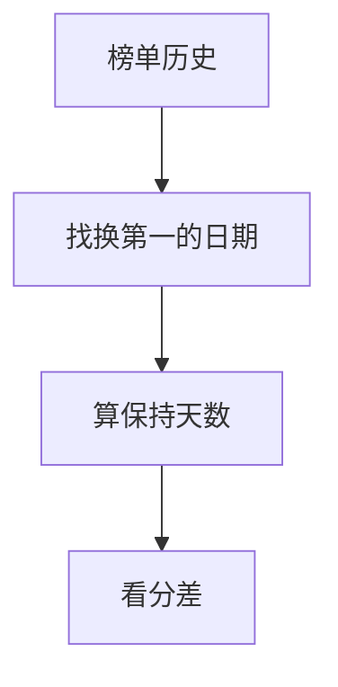

## Q
**领先者轮换多快**｜怎么读 · 追问

你想回答「前沿领先者轮换得有多快」。怎么用榜单数据做，而不是凭印象？

## A
**做法：**
1. 选一个榜（人类偏好榜或基准指数），按日期取每次**换第一名**的时间点；
2. 算每位领先者**保持第一的天数**；
3. 看第一名与第二名的**分差**，分差小于误差范围就算并列；
4. 换一个榜重做，对比是否同一家。

| 看到 | 说明 |
|---|---|
| 换手频繁、分差小 | 能力趋同，竞争转向价格与分发 |
| 单一领先者长期保持、分差大 | 有技术壁垒 |
| 不同榜第一不同 | 榜单测的东西不同（State of AI 2026 就观察到这一点） |

**陷阱：** 榜单规则会变，模型有不同版本；比较前固定口径。

**出处：** State of AI Report 2026；方法为通用数据分析。
