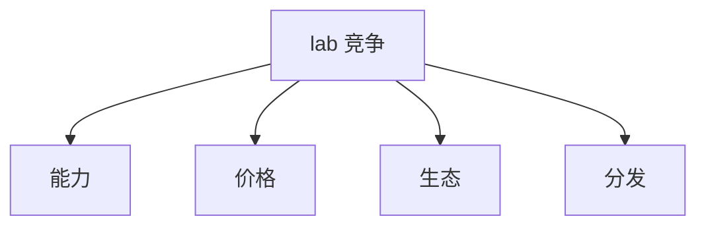

## Q
**Frontier labs · 竞争轴**｜摘要 · 必会

「谁是最强的模型公司」为什么没有稳定的答案？竞争发生在哪几条轴上？

## A
**Frontier lab**：训练最前沿通用模型的公司。State of AI Report 2026 的判断：前沿是三家公司（Anthropic、OpenAI、Google）的竞赛，不同榜单上领先者不同（Intelligence Index 与 Arena 的第一名不是同一家）。

| 轴 | 衡量 | 为什么重要 |
|---|---|---|
| 能力 | benchmark（标准化考题集，给模型打分）、人类偏好榜 | 决定谁被选为首选 |
| 价格 | 每百万 token 的价格 | 同能力的单价下降很快（见价格一卡） |
| 生态 | 工具、集成、开发者数量 | 迁移有成本 |
| 分发 | 谁拥有用户入口 | 同样的模型，入口决定用量 |

**怎么说「领先」：** 写出榜单名和日期。更好的问法是「领先了多久」：看第一名被取代的间隔，而不是看当下的名次。

**核对日期：** 2026-11-21。

出处

State of AI Report 2026（stateof.ai）。

