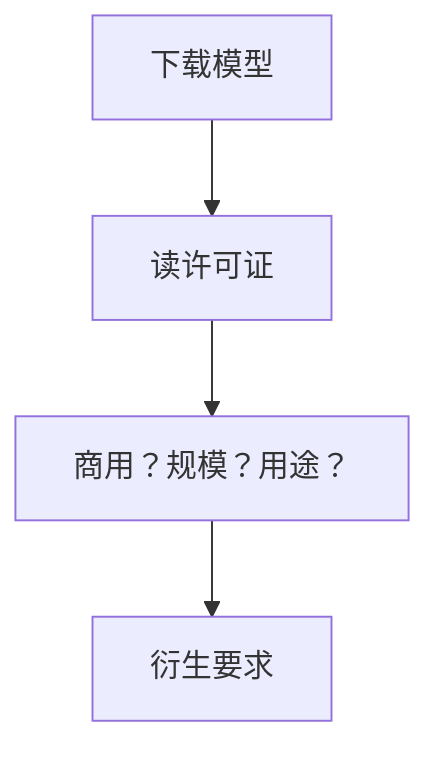

## Q
**模型许可证的分类**｜摘要 · 追问

「开源模型」可以商用吗？拿到一个 Hugging Face 上的模型，要看许可证的哪几项？

## A
**Hugging Face** 是托管模型与数据集的平台，类似代码界的 GitHub。

| 类型 | 典型特点 |
|---|---|
| 宽松开源许可（如 Apache 2.0、MIT） | 允许商用、修改、再分发；保留版权声明 |
| 社区或自定义许可 | 开放权重，但加了条件：大用户需另签协议、禁止某些用途、要求署名或沿用同名许可 |
| 仅限研究或非商用 | 不能用于商业产品 |

**必须看的五项：** 能否商用；对规模的限制；用途限制；衍生模型的要求（微调后的模型要不要沿用同样的许可）；是否限制用输出训练别的模型。

**提醒：** 开放权重 ≠ 开源（见前面）；训练数据常常不公开，所以数据的版权风险没有被许可证消除。

**出处：** 通用许可证分类；具体条款请读模型页面的 LICENSE。不是法律意见。
