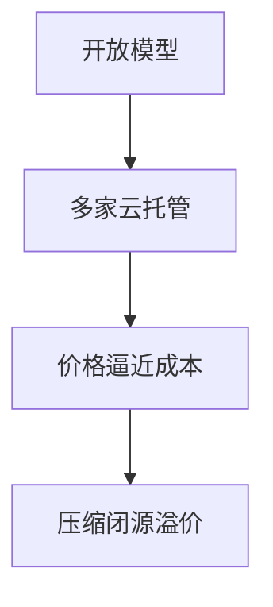

## Q
**Open weights 与 closed**｜摘要 · 必会

开放权重（open weights）模型与闭源模型的差距有多大？为什么有公司愿意开放权重？

## A
**先定义：** **Open weights**：公司公开训练好的模型参数，任何人能下载并在自己的机器上运行；训练数据和代码不一定公开，所以与 open source 不完全等同。**Closed**：只能通过公司的 API 或产品使用。

**数据：** Stanford AI Index 2025：开放与闭源模型在部分基准上的差距，一年内从 8% 缩到 1.7%。

| 开放的动机 | 逻辑 |
|---|---|
| 生态与分发 | 用的人多，工具和微调围绕它生长，抢标准 |
| 牵制对手 | 让对手无法对同等能力定高价 |
| 补充主业 | 云、芯片或硬件才是赚钱的地方 |
| 政策与形象 | 获得监管与社区的好感 |

**对价格的影响：** 开放模型任何云都能托管，推理价格被压到接近硬件成本，闭源厂商难以对同等能力定高价。

**核对日期：** 2026-11-21。

出处

Stanford HAI, AI Index Report 2025。

