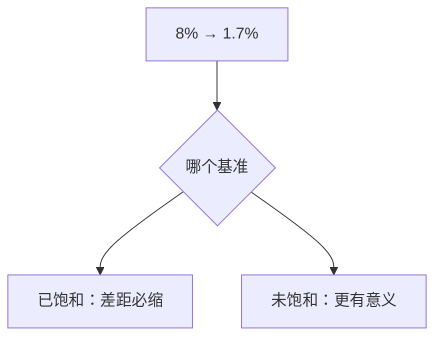

## Q
**「差距缩小到 1.7%」怎么读**｜怎么读 · 追问

报道说开放模型已经追平闭源，依据是「差距从 8% 缩到 1.7%」。这个数字在说什么，没说什么？

## A
| 说了 | 没说 |
|---|---|
| 在**某些基准**上差距变小 | 所有任务、所有场景 |
| 一年内变化 | 之后是否继续缩小 |
| 能力分数 | 部署成本、延迟、安全、许可证限制 |

**追问清单：** 哪个基准？被比的是当时最强的闭源还是同期可比的？基准是否已经饱和（分数接近上限，差距必然变小）？前沿领先的是几个月，而不是几个点？

**判断：** 差距变小对价格有压制效果；但「追平」要看你的任务上的评测。

出处

Stanford HAI, AI Index Report 2025（8% 到 1.7%，部分基准）。

