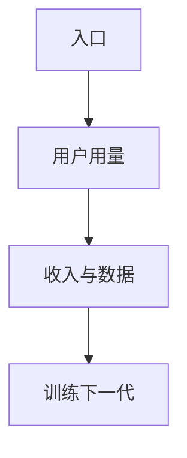

## Q
**谁拥有用户入口**｜摘要 · 追问

两家模型能力相近，为什么用量差很多？入口的竞争发生在哪几个地方？

## A
**Distribution（分发）**：用户在哪里第一次接触到 AI。

| 入口 | 优势 | 例子类型 |
|---|---|---|
| 搜索 | 已有大量日常使用 | 搜索引擎里的 AI 回答 |
| 操作系统与设备 | 默认安装、系统级权限 | 手机、电脑的内置助手 |
| 办公套件 | 用户已在里面干活，数据在里面 | 文档、邮件、表格里的助手 |
| 独立聊天入口 | 产品体验可以最快迭代 | 聊天应用 |

**为什么重要：** 默认入口决定用量，用量带来数据与收入，收入决定下一代模型的投入。

**怎么读：** 区分「触达」（装机量、月活）与「使用」（每次对话、付费）；入口的优势是触达，不一定是使用深度。

**出处：** 通用平台竞争分析；本卡不含数字。
