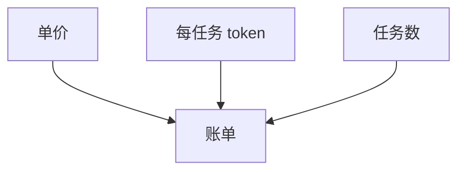

## Q
**Token 价格图怎么读**｜怎么读 · 必会

一张图显示「每百万 token 价格两年降了 100 倍」。你要先问哪几件事，才能决定这条曲线能不能代表你的账单？

## A
| # | 问题 | 为什么 |
|---|---|---|
| 1 | 比的是同一个模型，还是同一能力水平？ | 新模型更便宜 ≠ 旧模型降价 |
| 2 | 输入价还是输出价？ | 输出 token 通常更贵，你的负载比例决定账单 |
| 3 | 用什么基准定义「同等能力」？ | 基准选得不同，降幅不同（AI Index 280 倍，对应 GPT-3.5 水平） |
| 4 | 单任务用多少 token？ | 推理型模型会产生大量中间 token，单价降而单任务成本未必降 |
| 5 | 价格是列表价还是实际成交价？ | 企业折扣、缓存价、批处理价差别很大 |

**一句判断：** 价格下降是同能力下的趋势；你的成本 = 单价 × 每任务 token 数 × 任务数，三项要一起看。

**出处：** Stanford HAI, AI Index Report 2025（280 倍口径）；State of AI Report 2026。
