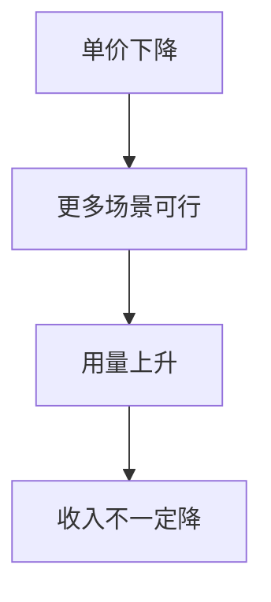

## Q
**Token 价格下降**｜摘要 · 必会

同样的能力，推理价格在多快地下降？降价为什么没有让模型公司的总收入缩水？

## A
**两条证据：**

| 来源 | 数字 | 口径 |
|---|---|---|
| Stanford AI Index 2025 | GPT-3.5 水平的系统，推理成本在 2022 年 11 月至 2024 年 10 月间下降 280 倍以上 | 固定能力水平的单价 |
| State of AI 2026（引 Epoch AI） | 达到某个固定基准分数的成本每季度下降 47%，约每年 13 倍 | 五个基准的平均 |

**两个口径要分开：** 价格图常常画「同一型号的价格」（降得慢），而这里是「同一能力水平的价格」（降得快，因为新模型更小更好）。

**为什么总收入没缩水：** 降价 → 用量上升（更便宜后更多场景可行；agent 一次任务用掉的 token 也比聊天多得多）。State of AI 2026：OpenAI 与 Anthropic 合计年化收入从年初约 300 亿美元升到夏末约 1050 亿美元。

**核对日期：** 2026-11-21。

**出处：** Stanford HAI, AI Index Report 2025；State of AI Report 2026（stateof.ai）。
